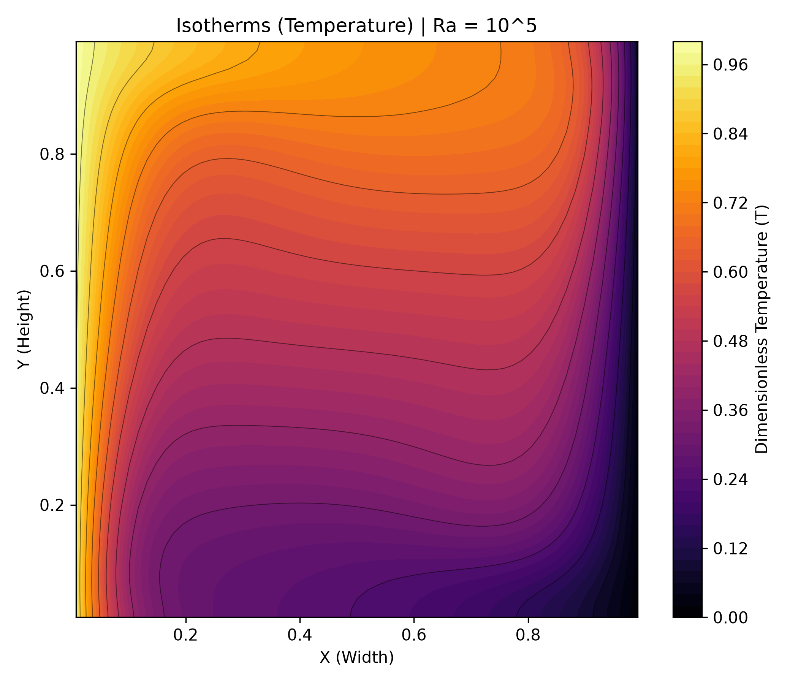

# 2D FVM Solver for Buoyancy-Driven Convection

<p>

</p>

This project details the numerical validation of buoyancy-driven natural convection within a differentially heated square cavity. It features a custom-built Python 2D Finite Volume Method (FVM) solver designed to model the transition from diffusion-dominated heat transfer to strongly convective flow regimes across Rayleigh Numbers (Ra) ranging from $10^3$ to $10^5$. 

## 🛠️ Technology Stack
* **Language:** Python
* **Numerical Computations:** NumPy
* **Visualization:** Matplotlib
* **Architecture:** Modular object-oriented scripting (`solver.py`, `plotter.py`, `config.py`)

## 📐 Computational Domain & Boundary Conditions

### 1. Problem Description
The computational domain is a classic 2D square cavity enclosing a Newtonian fluid (Prandtl Number = 0.71). 
* **Vertical Walls:** Isothermal left wall ($T = 1.0$) and cold right wall ($T = 0.0$).
* **Horizontal Walls:** Strictly adiabatic top and bottom boundaries.
* **Kinematics:** Standard no-slip boundary conditions enforced along all four solid walls.

### 2. Governing Equations
Fluid motion and thermal transport are governed by the fully coupled, incompressible 2D Navier-Stokes and Energy equations. The multiphysics coupling mechanism is achieved explicitly via the Boussinesq approximation:
* **Continuity:** $\nabla \cdot \mathbf{u} = 0$
* **X-Momentum:** $\frac{\partial(u^2)}{\partial x} + \frac{\partial(uv)}{\partial y} = -\frac{1}{\rho}\frac{\partial p}{\partial x} + \nu \nabla^2 u$
* **Y-Momentum (Boussinesq Source):** $\frac{\partial(uv)}{\partial x} + \frac{\partial(v^2)}{\partial y} = -\frac{1}{\rho}\frac{\partial p}{\partial y} + \nu \nabla^2 v + g\beta(T - T_{ref})$
* **Energy Transport:** $u\frac{\partial T}{\partial x} + v\frac{\partial T}{\partial y} = \alpha \nabla^2 T$

## 🧮 Numerical Methodology
* **Spatial Discretization:** 2nd-order Central Differencing Scheme (CDS).
* **Grid Architecture:** Uniform $64 \times 64$ staggered Cartesian grid (scalars at cell centers, velocities at cell faces to prevent checkerboard pressure oscillations).
* **Pressure-Velocity Coupling:** Semi-Implicit Method for Pressure Linked Equations (SIMPLE) algorithm.
* **Temporal Integration:** Pseudo-transient continuation via explicit 1st-order Forward Euler, constrained by a dynamically calculated von Neumann stability limit.

## 📊 Numerical Validation
The solver's accuracy is validated against the standard De Vahl Davis (1983) empirical benchmarks. 

| Rayleigh Number (Ra) | Parameter | Benchmark Value | Computed Value | Relative Error |
| :--- | :--- | :--- | :--- | :--- |
| **10³** | $Nu_{avg}$ | 1.118 | 1.1192 | 0.11% |
| | $U_{max}$ | 3.649 | 3.6515 | 0.06% |
| | $V_{max}$ | 3.697 | 3.7021 | 0.13% |
| **10⁴** | $Nu_{avg}$ | 2.243 | 2.3024 | 2.65% |
| | $U_{max}$ | 16.178 | 15.7952 | 2.37% |
| | $V_{max}$ | 19.617 | 20.2260 | 3.10% |
| **10⁵** | $Nu_{avg}$ | 4.519 | 4.5908 | 1.59% |
| | $U_{max}$ | 34.730 | 45.2192 | 30.20% |
| | $V_{max}$ | 68.590 | 70.4785 | 2.75% |

*Note: The numerical dispersion observed in $U_{max}$ at $Ra = 10^5$ is an expected consequence of exceeding the Grid Peclet limit on a fixed $64 \times 64$ mesh due to the highly compressed thermal boundary layers.*

## 📂 Repository Structure
```text
├── Results/                        
│   ├── Plot_Temperature_Ra_1000.png
│   ├── Plot_Temperature_Ra_10000.png
│   ├── Plot_Temperature_Ra_100000.png
│   ├── Plot_Velocities_Ra_1000.png
│   ├── Plot_Velocities_Ra_10000.png
│   ├── Plot_Velocities_Ra_100000.png
│   ├── results_Ra_1000.csv
│   ├── results_Ra_10000.csv
│   ├── results_Ra_100000.csv
│   └── validation_metrics.csv
├── config.py                       # Dimensionless parameters and grid configuration
├── main.py                         # Execution script
├── plotter.py                      # Matplotlib visualization and contour plotting functions
├── README.md
├── requirements.txt                # Python dependencies
└── solver.py                       # Core SIMPLE algorithm and FVM numerical logic
```

## 🚀 How to Run

### Prerequisites
- Python 3.10+
- Required libraries installed via `requirements.txt`

### Execution
Clone the repository and install dependencies:

```bash
git clone https://github.com/Oluwatobi-coder/2d-fvm-buoyancy-solver.git
cd 2d-fvm-buoyancy-solver
pip install -r requirements.txt
```

Run the numerical solver:
```bash
python main.py
```

*The solver will compute the steady-state fields based on the Rayleigh number specified in `config.py`. Visualizations and raw CSV data arrays will automatically export to the `Results/` directory.*

## 📚 References
- De Vahl Davis, G. (1983). Natural convection of air in a square cavity: A bench mark numerical solution. International Journal for Numerical Methods in Fluids, 3(3), 249-264.

- Patankar, S. V. (1980). Numerical Heat Transfer and Fluid Flow. Hemisphere Publishing.